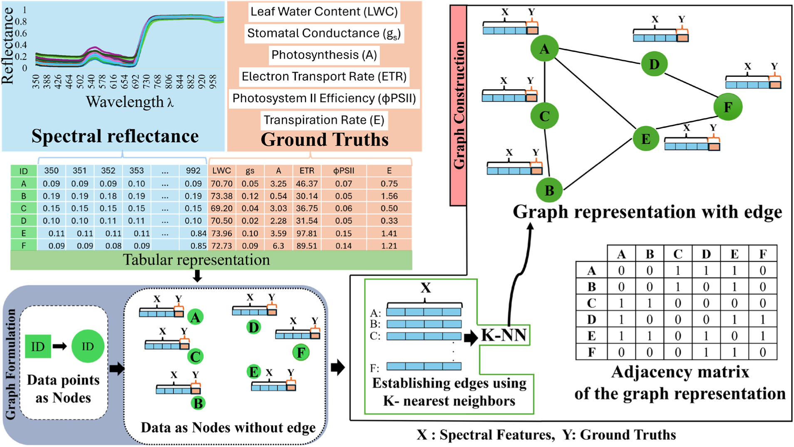
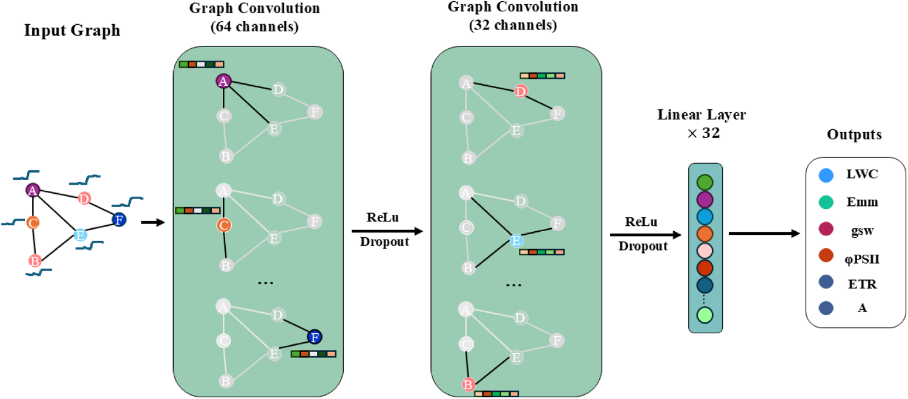

# Plant-GCN

Graph convolutional network that predicts blueberry physiological traits from canopy hyperspectral reflectance: leaf water content (LWC), transpiration rate (E), stomatal conductance (gs), photosystem II efficiency (ΦPSII), electron transport rate (ETR) and photosynthesis (A).

Official code for:

> Rahman, M. H., Busby, S., Hanif, S., Maruf, M. M., Ahmad, F., Ru, S., Sanz-Saez, A., Zheng, J., Rehman, T. U. (2025). **A graph convolutional network approach for hyperspectral image analysis of blueberries physiological traits under drought stress.** *Smart Agricultural Technology*, 10, 100743. [doi:10.1016/j.atech.2024.100743](https://doi.org/10.1016/j.atech.2024.100743)

This repository contains the preprocessing pipeline, graph construction, model, training and prediction code with the paper's configuration. No data is included (see [Data](#data)).

## Architecture

### Graph construction

Each plant is one node. Its node feature vector is the preprocessed average spectral reflectance of the plant (log10(1/R) → multiplicative scatter correction → mean-centring), and its node labels are the measured physiological traits. Edges are built with k-nearest neighbours on the spectral features (k = 3 in the paper), giving a symmetric adjacency matrix. Training and validation nodes form one graph; the loss is computed on training nodes only, and the graph convolutions let information flow along the edges (transductive learning).



*Fig. 1 of the paper: tabular spectra and ground truths become nodes; edges are established with k-NN on the spectral features.*

### Plant-GCN

Two graph convolutional layers (64 and 32 channels), each followed by ReLU, then dropout (30 %) and one linear layer that outputs all traits at once.



*Fig. 2 of the paper: Plant-GCN.*

Layer-wise propagation (Kipf & Welling): `H(l+1) = ReLU( D̂^-1/2 Â D̂^-1/2 H(l) W(l) )`, with `Â = A + I` and `D̂` its degree matrix.

```
spectra X (N x 180) ──► k-NN graph (A, X)
       │
       ▼
GCNConv 180 → 64 ─► ReLU ─► GCNConv 64 → 32 ─► ReLU ─► Dropout 0.3 ─► Linear 32 → T
       │
       ▼
   T traits per node (LWC, E, gs, ΦPSII, ETR, ...)
```

| hyperparameter | value (paper) |
|---|---|
| k nearest neighbours | 3 |
| GCN channels | 64, 32 |
| dropout | 0.3 |
| loss | MSE on standardised targets |
| optimiser | Adam, weight decay 1e-5 |
| learning rate | linear warm-up, then reduce-on-plateau on validation RMSE |
| augmentation | random offset (6 % of band std) and slope (±5 %) |

### Training pipeline

1. Stratified 85:15 hold-out test split (by treatment and day), made before any augmentation.
2. Offset/slope augmentation of the train-val spectra (`augmentation.mode: online`, default, redraws the jitter each epoch on the real-plant graph; `static` draws `n_copies` fixed copies per plant and makes them nodes, the paper's protocol).
3. 70:30 train/validation node split (group-aware, so copies of one plant stay on one side).
4. log10(1/R) → MSC → mean-centring, fitted on the training nodes only; targets standardised with the training mean and std.
5. Full-batch transductive training with early stopping on validation RMSE.
6. Test: the held-out spectra are preprocessed with the training statistics, appended to the train-val graph (k-NN rebuilt), and predicted; their labels are never used. `predict.py` does the same for new spectra using the reference graph stored in `model.pt`.

## Installation

```bash
git clone https://github.com/hasiburniloy/plant-gcn.git
cd plant-gcn
pip install -e .
```

PyTorch and PyTorch Geometric may need a platform-specific install; see [pytorch.org](https://pytorch.org/get-started/locally/) and [PyG](https://pytorch-geometric.readthedocs.io/en/latest/install/installation.html). Tested with Python 3.9–3.12, PyTorch ≥ 2.0, PyG ≥ 2.3.

## Data

Data files are not part of this repository. Provide one table, one row per plant, `.xlsx` or `.csv`:

| Day | PlantID | Genotype | Treatment | RWC | Emm | gsw | PhiPS2 | ETR | 514 | 516 | … | 1000 |
|---|---|---|---|---|---|---|---|---|---|---|---|---|

- Reflectance columns: headers are wavelengths in nm, values in (0, 1]. They are detected automatically as the numeric-named columns; `data.spectral_columns` / `data.wavelength_range` in the config can restrict them.
- Target columns are listed in `data.target_columns`; metadata columns are anything else. `data.stratify_columns` (default `[Treatment, Day]`) must exist, or be set to `[]`.

A synthetic table with the right layout can be generated for a dry run:

```bash
python scripts/make_example_data.py --out example_data.csv
```

## Usage

Run from the repository root.

**Train**

```bash
python -m plant_gcn.train --config plant_gcn/config.yaml --data path/to/data.xlsx --out runs/plant_gcn
```

Any config value can be overridden on the command line: `--set graph.k=5 --set training.epochs=2000 --set seeds=[1,2,3]`. Test sets are small, so `--repeat-splits 5` repeats the whole run on five different test splits and reports mean ± std.

Outputs per run (`runs/plant_gcn/seed_<s>/`, or `split_<ss>/seed_<s>/` with several test splits): `model.pt` (weights, fitted preprocessing, reference graph nodes), `metrics.json` (train / val / test R² and RMSE per target, original units), `predictions_{train,val,test}.csv`, `metrics_test_by_Day.json`, `parity_plot.png`, `loss_curve.png`; `summary.json` aggregates all runs.

**Predict**

```bash
python -m plant_gcn.predict --model runs/plant_gcn/seed_42/model.pt --data new_spectra.xlsx --out predictions.csv
```

The new file needs the same spectral columns as training. The output has the non-spectral columns plus `<target>_predicted`; R² and RMSE are printed if the target columns are present.

**Test**

```bash
pytest -q
```

## Configuration

All keys are documented in [`plant_gcn/config.yaml`](plant_gcn/config.yaml):

| group | keys |
|---|---|
| `data` | path, filter, spectral_columns, wavelength_range, target_columns, stratify_columns, test_size, split_seed |
| `balance` | enabled (SMOTE-ENN of train-val, off for Plant-GCN), target, threshold |
| `augmentation` | enabled, mode online/static, n_copies, include_original, offset_percent, slope_variation |
| `split` | val_size, group_aware |
| `graph` | k |
| `model` | name gcn/gat, hidden1, hidden2, dropout |
| `training` | lr, weight_decay, warmup_epochs, plateau_patience, epochs, early_stopping_patience |
| `seeds`, `output_dir` | training seeds; output folder |

## Repository layout

```
plant_gcn/
  common/         shared pipeline: io, preprocessing, augment, balance, split, dataset, metrics, utils
  graph.py        k-NN edge construction, graph building, appending new nodes
  model.py        PlantGCN (and a GAT variant)
  train.py        training / evaluation CLI
  predict.py      prediction CLI for new spectra
  config.yaml     paper configuration
scripts/make_example_data.py   synthetic table for a dry run
tests/            smoke tests on synthetic data
docs/             figures
```

## Citation

```bibtex
@article{rahman2025plantgcn,
  title   = {A graph convolutional network approach for hyperspectral image analysis of blueberries physiological traits under drought stress},
  author  = {Rahman, Md. Hasibur and Busby, Savannah and Hanif, Sajid and Maruf, Md Mesbahul and Ahmad, Faraz and Ru, Sushan and Sanz-Saez, Alvaro and Zheng, Jingyi and Rehman, Tanzeel U.},
  journal = {Smart Agricultural Technology},
  volume  = {10},
  pages   = {100743},
  year    = {2025},
  doi     = {10.1016/j.atech.2024.100743}
}
```

## License

MIT, see [`LICENSE`](LICENSE).
